# DevOps Capstone: Server Container

A Dockerized Python server that creates a 1 KB file of random text in a Docker volume and sends that file and its SHA-256 checksum to any client that connects. The server runs with Docker Compose, stores its data in a named volume (`servervol`) and listens on port `5000`.

## Assignment Question

```bash
# Server Container Tasks
1. Choose an appropriate base image from the Official Images list.
2. Create a Dockerfile for the server container with the following specifications:
   - Use a volume named "servervol" and mount it at "/serverdata" in the container.
   - Install necessary packages and dependencies required for your server application.
3. Write a server application in your preferred language that does the following:
   - Creates a 1 KB file with random text data in the "/serverdata" directory.
   - Sends the file and its checksum to the client.
4. Use Docker Compose to define and run the server container.
```

---

## Project Structure

```bash
devops-capstone-server/
├── Dockerfile           # Builds the server image from python:3.12-slim
├── docker-compose.yml   # Defines the server service, servervol volume and filenet network
├── server.py            # TCP server: creates the 1 KB file and sends it with its checksum
├── images/              # Screenshots of the project running
└── README.md
```


## How It Works

1. The container starts and the server listens on `0.0.0.0:5000`.
2. When a client connects, the server writes a new 1 KB random text file to `/serverdata/random_file.txt`.
3. The server computes the file's **SHA-256** checksum.
4. It sends one JSON header line, followed by the raw file bytes:

```bash
{"filename": "random_file.txt", "size": 1024, "checksum": "<sha256>"}\n<1024 bytes of file data>
```

## Tech Stack

| Component    | Choice                         |
|--------------|--------------------------------|
| Base image   | `python:3.12-slim` (official)  |
| Language     | Python 3 (standard library only) |
| Volume       | `servervol` → `/serverdata`    |
| Network      | `filenet`                      |
| Port         | `5000`                         |


## Getting Started

### 1. Clone the repository

```bash
git clone https://github.com/Amin-0513/devops-capstone-server.git
cd devops-capstone-server
```

### 2. Build and start the server

```bash
docker compose up -d --build
```

### 3. View the server logs

```bash
docker compose logs -f
```

### 4. Check that the volume exists

```bash
docker volume ls | grep servervol
```

### 5. Verify the file's checksum inside the volume

```bash
docker run --rm -v servervol:/data alpine sha256sum /data/random_file.txt
```

### 6. Stop the server

```bash
docker compose down
```

---

## Screenshots

### 1. Building and starting the container

`docker compose up -d --build` builds the image from the official `python:3.12-slim` base. It then creates the `servervol` volume and the `filenet` network and starts the `server` container.

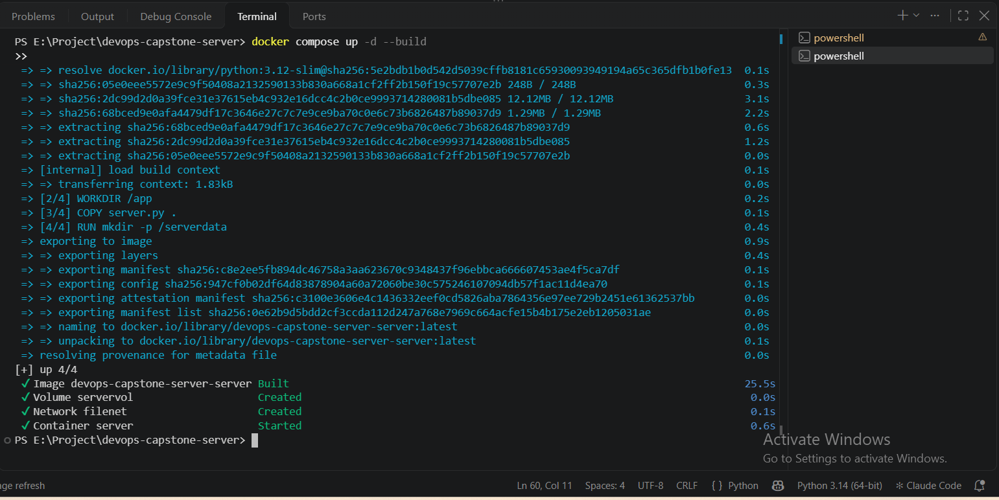

### 2. Server logs: file created and sent

The logs show the server listening on port 5000. For each client connection, it creates `/serverdata/random_file.txt` (1024 bytes) and sends it with its SHA-256 checksum.

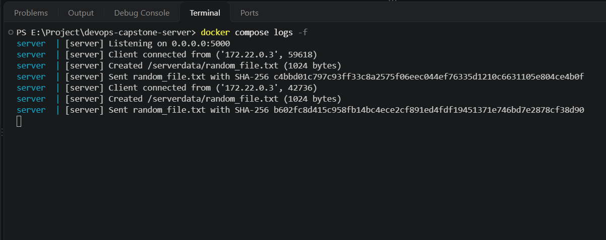

### 3. Docker volumes

`docker volume ls` shows the `servervol` volume used by the server, next to the `clientvol` volume used by the client project.

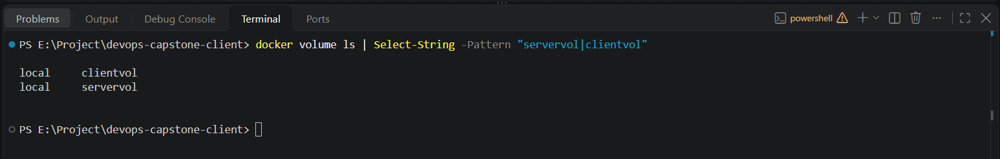

### 4. Checksum verification

Running `sha256sum` on the file inside `servervol` gives the same hash that the server sent to the client in the last log line. The file in the volume matches the one that was sent.

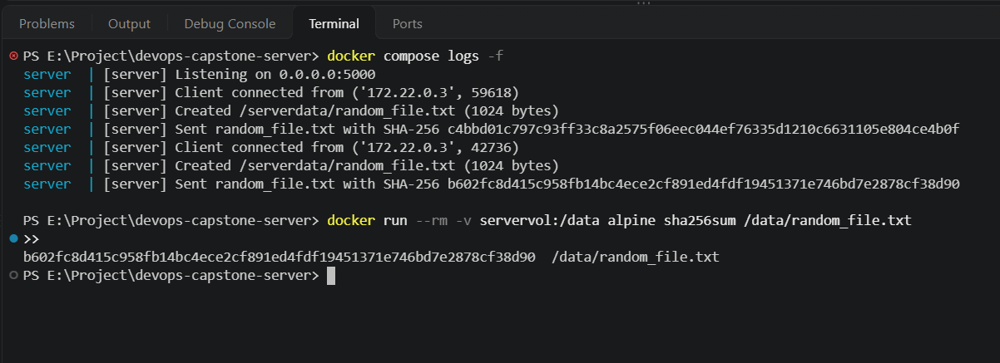


---

# DevOps Capstone: Creating VMs, Infra as a Code (IaC) (PART 2)

Two AWS EC2 instances run in the same VPC and public subnet: `saa-server` hosts the server container and `saa-client` hosts the client container. A shared security group lets the two instances talk to each other inside the VPC, and Terraform scripts in the [`terraform/`](terraform/) folder automate the setup.

## Assignment Question

```bash
# Part 2 has 3 sub-parts:
2a. Create two AWS EC2 instances (VMs), one for hosting the server container and
    another for hosting the client container.
2b. Configure the VPC and subnets appropriately to allow communication between the
    two EC2 instances. Use the t2.micro instance type, which is covered in the AWS
    free tier.
2c. Use Terraform for infrastructure automation. Place your Terraform scripts in the
    "terraform" directory of your client and server GitHub repositories.
```

## AWS Resources

| Resource        | Name / Value                                   |
|-----------------|------------------------------------------------|
| Region          | `ap-southeast-2` (Sydney), AZ `ap-southeast-2a` |
| VPC             | `saa-vpc`, CIDR `10.0.0.0/16`                  |
| Subnet          | `saa-subnet-public1-ap-southeast-2a`, CIDR `10.0.0.0/20` |
| Internet gateway | Attached to `saa-vpc`, with a public route table |
| Security group  | `saa-sg`                                       |
| Key pair        | `saa-key` (RSA, `.pem`)                        |
| AMI             | Ubuntu 26.04 LTS (64-bit x86)                  |
| Instance type   | `t3.micro` (free tier eligible)                |

> The assignment asks for `t2.micro`, but this AWS account's Free Plan only allows `t3.micro`, so both instances use `t3.micro`.
| Instances       | `saa-server`, `saa-client`                     |

---

## 2b. Configure the VPC and Subnets

### Step 1: Create the VPC

In **VPC → Create VPC**, choose **VPC and more**, name it `saa-vpc` and select 1 Availability Zone, 1 public subnet and 0 private subnets. Both instances go in this one public subnet, so they can reach each other directly.

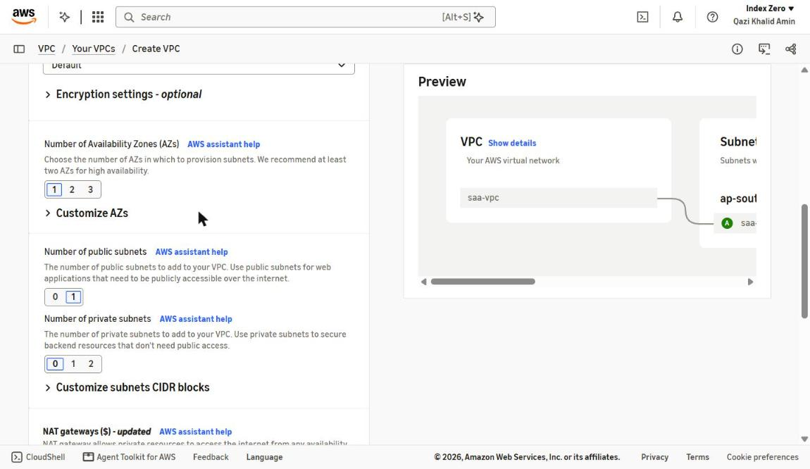

### Step 2: VPC created

AWS creates the VPC, the public subnet and the internet gateway. It also creates a public route table with a route to the internet and links it to the subnet. DNS hostnames and DNS resolution are turned on.

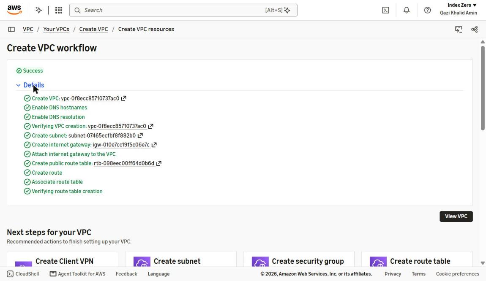

### Step 3: Create the security group inbound rules

In **EC2 → Security Groups → Create security group**, create `saa-sg` in `saa-vpc` with these inbound rules:

| Type        | Port | Source        | Purpose                                     |
|-------------|------|---------------|---------------------------------------------|
| Custom TCP  | 22   | `0.0.0.0/0`   | SSH access to the instances                 |
| Custom TCP  | 8080 | `0.0.0.0/0`   | Application port                            |
| All traffic | All  | `10.0.0.0/16` | Lets the server and client talk inside the VPC |

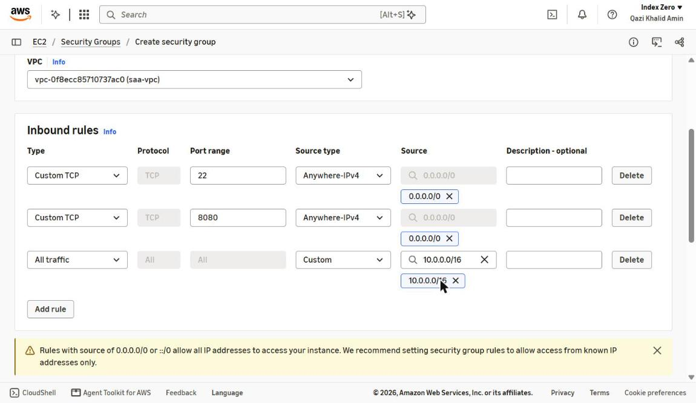

### Step 4: Security group created

The `saa-sg` security group is created with 3 inbound rules and is attached to `saa-vpc`.

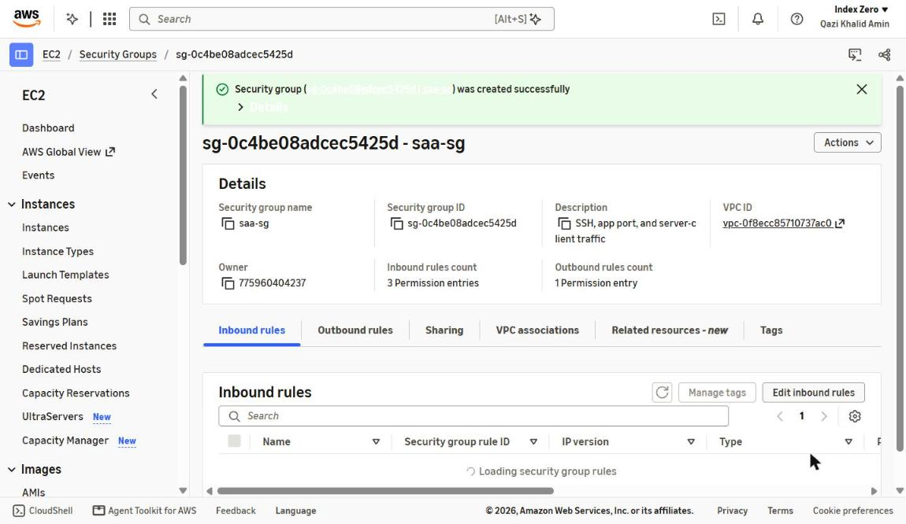

---

## 2a. Create the Two EC2 Instances

### Step 5: Create a key pair

In **EC2 → Key pairs → Create key pair**, create `saa-key` with type **RSA** and format **.pem**. The `.pem` file downloads once and is used to SSH into both instances.

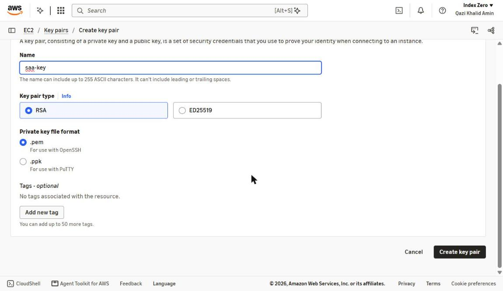

### Step 6: Key pair created

The `saa-key` key pair now appears in the key pairs list.

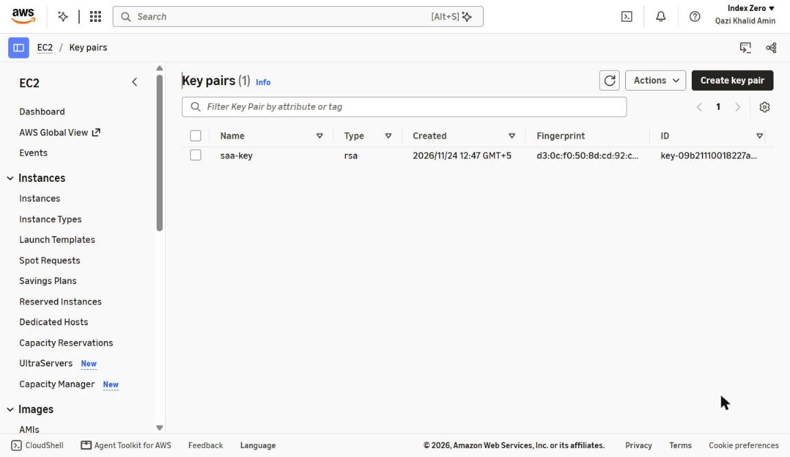

### Step 7: Launch the server instance

In **EC2 → Instances → Launch an instance**, name the instance `saa-server` and choose the **Ubuntu** AMI.

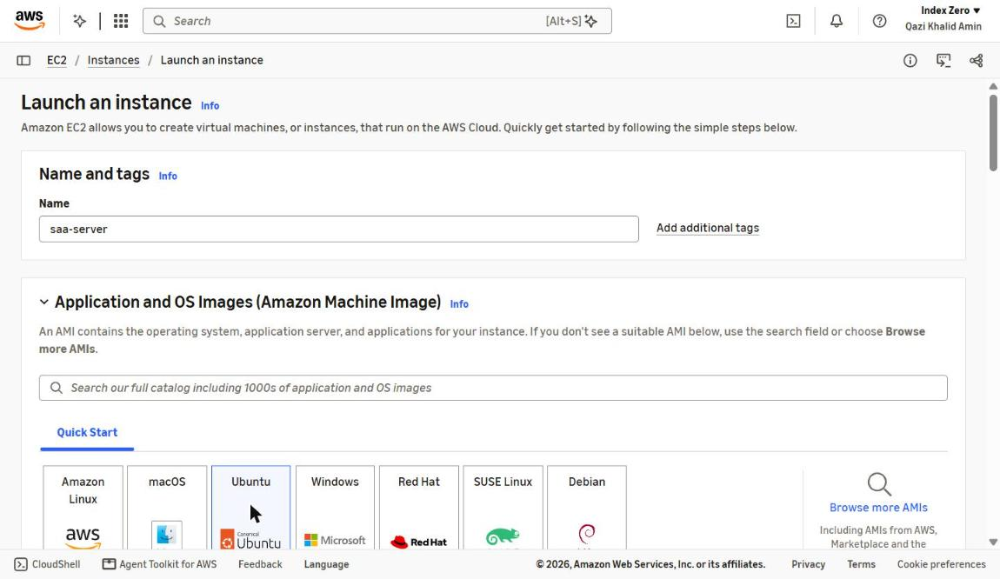

### Step 8: Choose the instance type and key pair

Choose the free-tier-eligible `t3.micro` instance type and select the `saa-key` key pair.

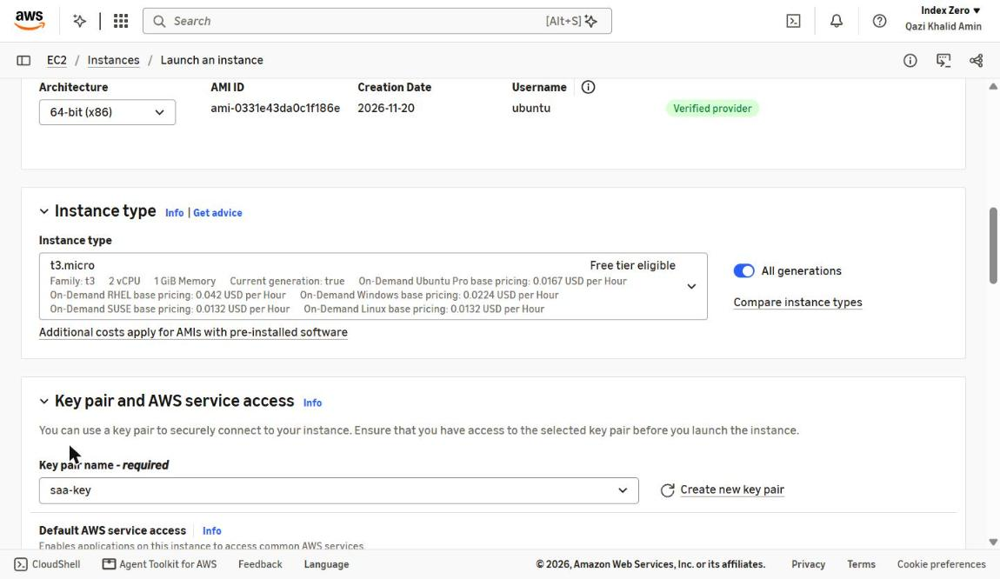

### Step 9: Network settings

Choose `saa-vpc` and the public subnet, turn on **Auto-assign public IP**, and select the existing `saa-sg` security group.

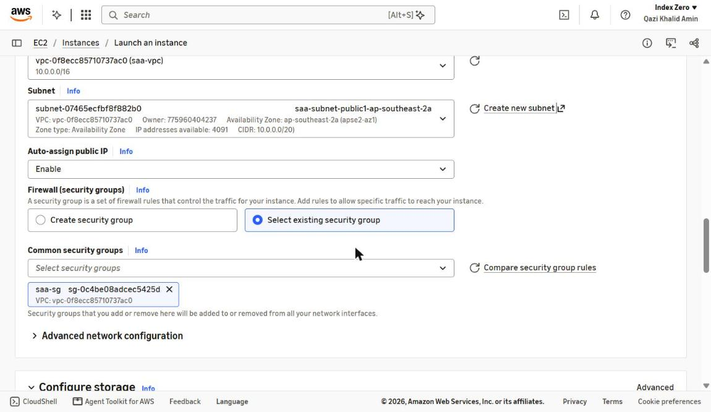

### Step 10: Review the summary

Check the summary (Ubuntu AMI, `t3.micro`, `saa-sg`, 8 GiB storage) and click **Launch instance**.

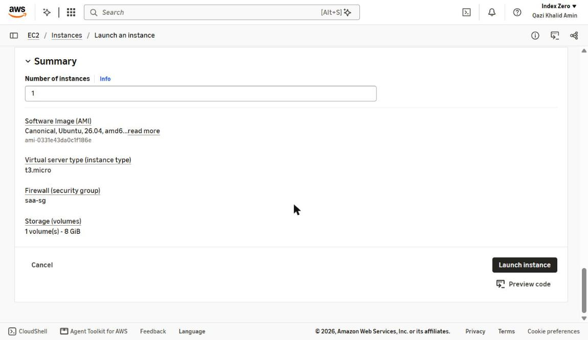

### Step 11: Server instance launched

AWS confirms that the `saa-server` instance has started launching. Repeat Steps 7–11 with the name `saa-client` to create the client instance.

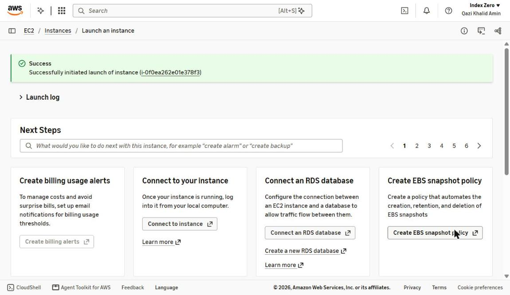

### Step 12: Both instances running

`saa-server` and `saa-client` are both **Running** as `t3.micro` in `ap-southeast-2a`, each with its own public IPv4 DNS name.

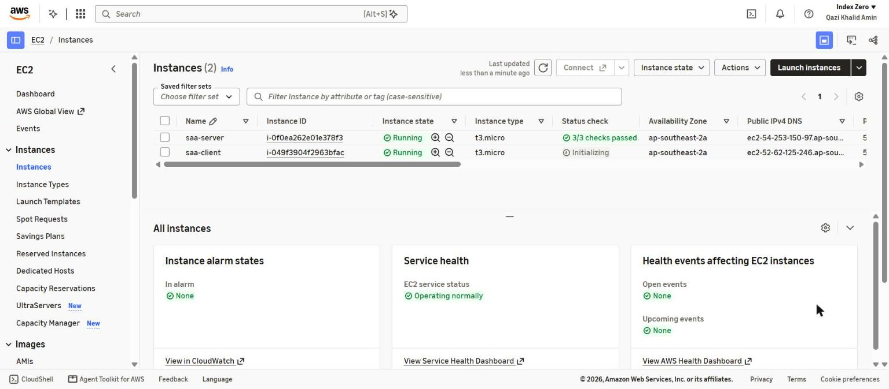

---

## 2c. Terraform (Infrastructure as Code)

The Terraform scripts are in the [`terraform/`](terraform/) folder:

```bash
terraform/
├── main.tf        # AWS provider, Ubuntu AMI, VPC, subnet, internet gateway, route table, security group, server EC2 (installs Docker, Docker Compose and Git on startup)
├── variables.tf   # Region, CIDRs, instance type, key name, SSH range, server port
└── outputs.tf     # VPC, subnet and security group IDs, server public and private IPs
```

### What Terraform creates

| Resource          | Terraform name                    | Value                                  |
|-------------------|-----------------------------------|----------------------------------------|
| VPC               | `aws_vpc.saa_vpc`                 | `saa-vpc`, `10.0.0.0/16`, DNS enabled  |
| Public subnet     | `aws_subnet.saa_public_subnet`    | `10.0.0.0/20` in `ap-southeast-2a`, public IP on launch |
| Internet gateway  | `aws_internet_gateway.saa_igw`    | `saa-igw`                              |
| Route table       | `aws_route_table.saa_public_rt`   | `0.0.0.0/0` → internet gateway         |
| Security group    | `aws_security_group.saa_sg`       | SSH (22), server port (5000), all traffic inside `10.0.0.0/16` |
| Server instance   | `aws_instance.server`             | `saa-server`, Ubuntu 22.04, `t3.micro` |

The client repository's Terraform creates `saa-client` in the same VPC, subnet and security group, so the client can reach the server on its private IP (`server_private_ip` output) at port `5000`.

### Run Terraform

```bash
cd terraform
terraform init       # Download the AWS provider
terraform validate   # Check the configuration
terraform plan       # Preview the resources to be created
terraform apply      # Create the infrastructure
terraform output     # Show the server's public and private IPs
```

### Connect to the server instance

```bash
chmod 400 saa-key.pem
ssh -i saa-key.pem ubuntu@<server-public-ip>
```

---

## Verification

### 1. Check the Terraform code

```bash
cd terraform
terraform init
terraform fmt -check
terraform validate
```

`terraform validate` prints **Success! The configuration is valid** when there are no errors.

`terraform init` downloads the AWS provider (`hashicorp/aws` v5.100.0) and initializes the working directory.

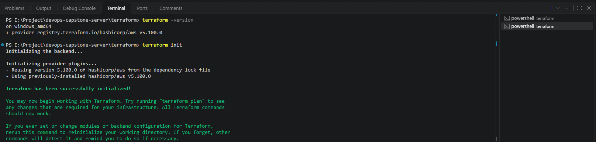

### 2. Create the infrastructure

```bash
aws configure          # access key, secret key, region ap-southeast-2
terraform plan         # Plan: 7 to add
terraform apply        # type: yes
terraform output       # note server_public_ip and server_private_ip
```

#### Terraform plan

`terraform plan` reads the latest Ubuntu 22.04 AMI and lists the resources it will create, including the `aws_instance.server` with instance type `t3.micro`.

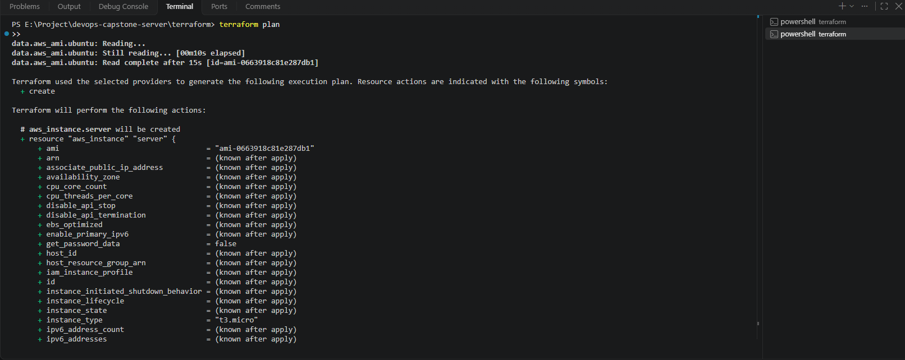

#### Terraform apply

`terraform apply` creates all 7 resources: the VPC, internet gateway, subnet, security group, route table, route table association and the server EC2 instance. It ends with **Apply complete! Resources: 7 added, 0 changed, 0 destroyed.**

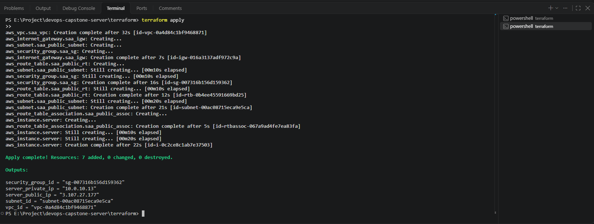

#### Terraform output

`terraform output` shows the IDs of the new VPC, subnet and security group, and the server's public IP and private IP (`10.0.10.13`). The client uses the private IP to reach the server inside the VPC.

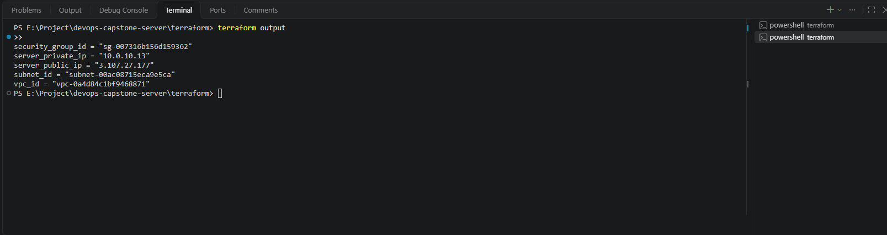

Then run `terraform init` and `terraform apply` in the client repository's `terraform/` folder, so `saa-client` is created in the same VPC, subnet and security group. Both instances should show as **Running** (`t3.micro`) in the EC2 console.

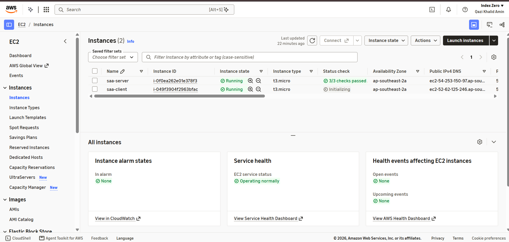

### 3. Start the server container

```bash
ssh -i saa-key.pem ubuntu@<server_public_ip>
docker --version
git clone https://github.com/Amin-0513/devops-capstone-server.git
cd devops-capstone-server
docker compose up -d --build
docker compose logs -f
```

### 4. Connect from the client instance

```bash
ssh -i saa-key.pem ubuntu@<client_public_ip>
python3 - <<'EOF'
import socket, json, hashlib
s = socket.create_connection(("<server_private_ip>", 5000))
data = b""
while chunk := s.recv(4096):
    data += chunk
header, body = data.split(b"\n", 1)
meta = json.loads(header)
print("Received:", meta["filename"], len(body), "bytes")
print("Checksum OK:", hashlib.sha256(body).hexdigest() == meta["checksum"])
EOF
```

### 5. Expected result

```bash
Received: random_file.txt 1024 bytes
Checksum OK: True
```

The server log shows `Client connected from ('10.0.x.x', ...)`. This proves the two EC2 instances talk to each other over the private network inside the VPC.

### 6. Destroy the infrastructure

Destroy the client first, then the server, because the client uses the server's VPC:

```bash
cd <client-repo>/terraform && terraform destroy
cd <server-repo>/terraform && terraform destroy
```


---

# DevOps Capstone: Setting up Monitoring Stack (PART 3)

### 1. Opening port 3020 with Terraform

`terraform apply` updates only the security group (0 added, 1 changed, 0 destroyed) to allow port `3020` from the internet. The output shows the Grafana address of the server VM.

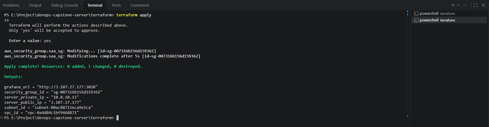

### 2. Grafana login page

Grafana opens over the internet at port `3020` of the server's public IP. You log in as `admin` to reach the dashboards.

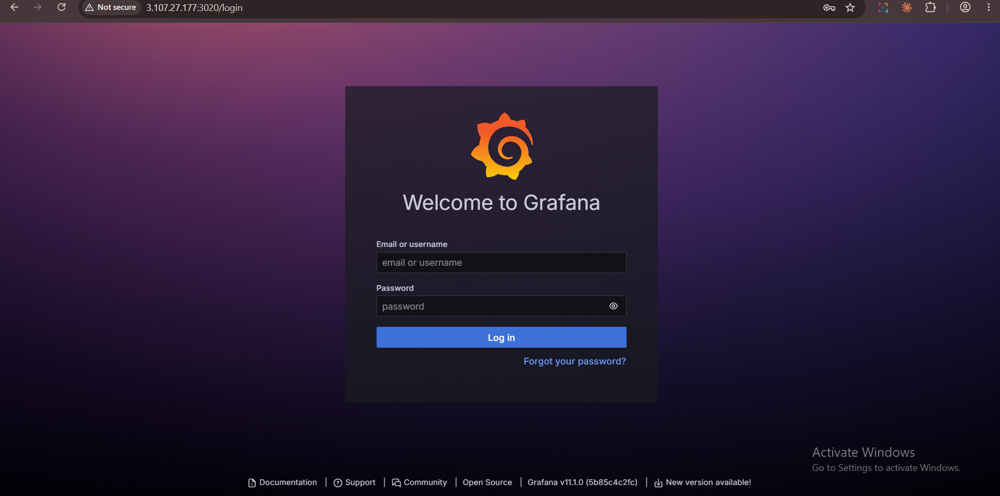

### 3. Docker container metrics dashboard

The **Server - Docker Container Metrics** dashboard shows 5 running containers (`server`, `grafana`, `prometheus`, `node-exporter`, `cadvisor`). It shows CPU, memory and network usage for each container, collected by cAdvisor and Prometheus.

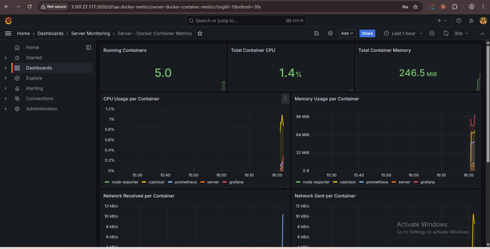

---

# DevOps Capstone: Setting up CI/CD Pipelines (PART 4)

The server repository gets a CI/CD pipeline that builds the server image, pushes it to Docker Hub, and deploys it to the server EC2 instance through a private (self-hosted) GitHub Actions runner. Slack receives a notification after each deployment.

## Assignment Question

```bash
# Part 4: Setting up CI/CD Pipelines
1. Create two separate Git repositories for the server and client codebases, if not done already.
2. Set up CI/CD pipelines for both repositories to ensure the following:
   - Images are pushed to a public registry like Docker Hub.
   - Configure the corresponding VMs as private Git runners.
   - Update the image tag in Docker Compose, pull the new image, and deploy it as part of the CD process.
   - Integrate a Slack webhook (or another app of your choice) for deployment notifications.
```

## Progress

| Task | Status |
|------|--------|
| Separate server and client repositories | ✅ Done |
| Server VM configured as a private GitHub runner (`saa-server`, label `server-vm`) | ✅ Done |
| Push images to Docker Hub | ⏳ Next |
| Update image tag in Docker Compose, pull and deploy | ⏳ Next |
| Slack deployment notifications | ⏳ Next |

## Configure the Server VM as a Private GitHub Runner

### Step 1: Open the runners page

On GitHub, go to **Settings → Actions → Runners**. No runners are configured yet. Click **New self-hosted runner**.

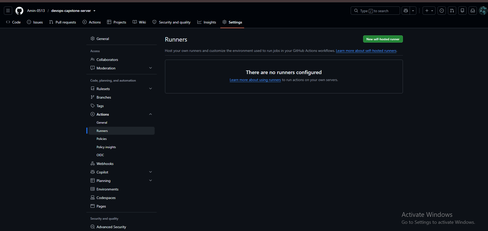

### Step 2: Get the runner commands

Choose **Linux** and **x64**. GitHub shows the download commands and a one-time registration token (hidden in the screenshot).

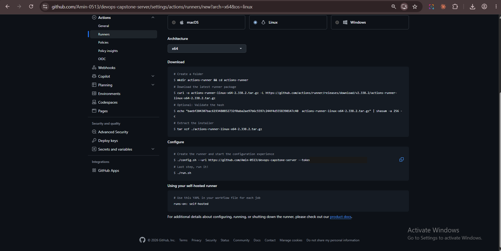

### Step 3: Add swap memory on the server VM

The `t3.micro` instance has only 1 GB of memory, so 1 GB of swap is added before installing the runner:

```bash
ssh -i saa-key.pem ubuntu@<server_public_ip>
sudo fallocate -l 1G /swapfile
sudo chmod 600 /swapfile
sudo mkswap /swapfile
sudo swapon /swapfile
echo '/swapfile none swap sw 0 0' | sudo tee -a /etc/fstab
```

### Step 4: Download the runner

```bash
mkdir -p ~/actions-runner && cd ~/actions-runner
curl -o actions-runner-linux-x64-2.338.2.tar.gz -L https://github.com/actions/runner/releases/download/v2.338.2/actions-runner-linux-x64-2.338.2.tar.gz
echo "baebf204307bac6193480852732f0aba2ae97b6c5597c244f4d5558390147c40  actions-runner-linux-x64-2.338.2.tar.gz" | sha256sum -c
tar xzf ./actions-runner-linux-x64-2.338.2.tar.gz
sudo ./bin/installdependencies.sh
```

### Step 5: Register the runner

```bash
./config.sh --unattended \
  --url https://github.com/Amin-0513/devops-capstone-server \
  --token <REGISTRATION_TOKEN> \
  --name saa-server \
  --labels server-vm \
  --work _work \
  --replace
```

The runner connects to GitHub and registers with the label `server-vm`, which the deploy job uses to pick this VM.

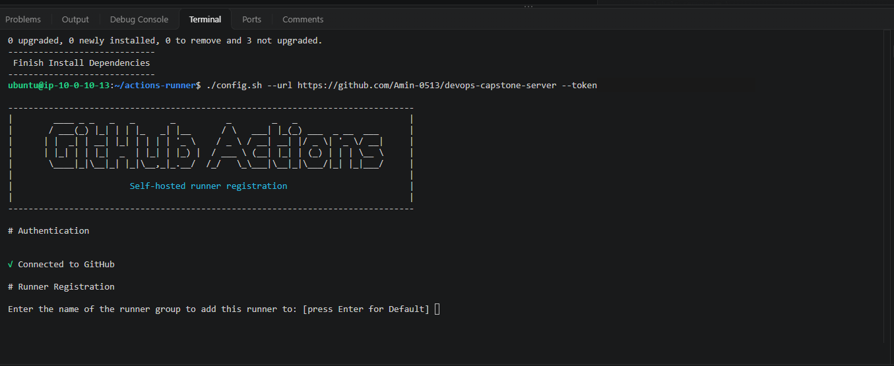

### Step 6: Run the runner as a service

The runner is installed as a systemd service, so it keeps running after logout and starts again after a reboot:

```bash
sudo usermod -aG docker ubuntu
sudo ./svc.sh install ubuntu
sudo ./svc.sh start
sudo ./svc.sh status --no-pager
```

### Step 7: Runner online

The runner **saa-server** shows as **Idle** with the labels `self-hosted`, `Linux`, `X64` and `server-vm`, ready to receive jobs.

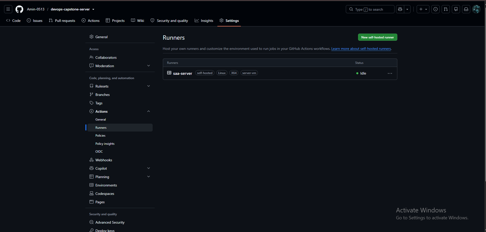
